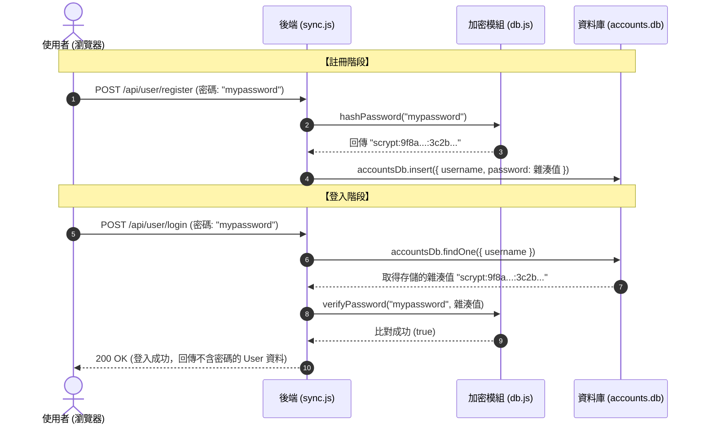

# 🎓 網站系統設計實戰：從課堂 Express 到期末圖書館專案的 NeDB 與全端架構教學指南

> 💡 **這是一份專為「網站系統設計」課程量身打造的學習與複習指南**。
> 本指南將課堂上學到的核心理論（Express、Body-Parser、NeDB、HTTP 方法）與你的「個人網頁收藏圖書館（Web Library）」期末專案真實程式碼逐行拆解對照，幫助你徹底搞懂前後端互動、資料庫操作、資安加密、動態網頁 CMS 以及 Docker 容器化！

---

## 📑 目錄

1. [第一章：現代網頁系統全貌與架構分層 (Web Architecture 101)](#第一章現代網頁系統全貌與架構分層)
2. [第二章：老師課堂代碼深入拆解 (根目錄 server.js 逐行解構)](#第二章老師課堂代碼深入拆解)
3. [第三章：NeDB 嵌入式 NoSQL 資料庫完全手冊 (增刪查改實戰)](#第三章nedb-嵌入式-nosql-資料庫完全手冊)
4. [第四章：資安與前端儲存演進：從明文 localStorage 到加鹽雜湊](#第四章資安與前端儲存演進)
5. [第五章：期末圖書館專案核心代碼剖析 (Code Walkthrough)](#第五章期末圖書館專案核心代碼剖析)
6. [第六章：什麼是「把區塊寫進資料庫」的動態網頁 (CMS 觀念解析)](#第六章什麼是把區塊寫進資料庫的動態網頁)
7. [第七章：Docker 容器化部署與微服務架構 (Volume 資料持久化)](#第七章docker-容器化部署與微服務架構)
8. [第八章：課堂期末答辯與未來延伸學習地圖](#第八章課堂期末答辯與未來延伸學習地圖)

---

## 第一章：現代網頁系統全貌與架構分層

在學習任何網頁技術前，先在腦袋中建立這張「全端三層架構圖」：

```mermaid
flowchart LR
    subgraph Client["用戶端 (Frontend / Browser)"]
        HTML["HTML (骨架)"]
        CSS["CSS (皮膚排版)"]
        JS["JavaScript (大腦動態)"]
        Storage["sessionStorage (臨時記憶)"]
    end

    subgraph Network["網路傳輸層 (HTTP / HTTPS)"]
        REQ["Request (GET / POST / PUT / DELETE)"]
        RES["Response (JSON / HTML / Status Code)"]
    end

    subgraph Server["伺服器端 (Backend / Node.js)"]
        Routing["路由分發 (Router)"]
        Parser["中介軟體 (body-parser)"]
        Logic["業務邏輯 (驗證、加鹽加密)"]
    end

    subgraph Database["資料庫層 (NeDB / NoSQL)"]
        Accounts["accounts.db (帳號與密碼)"]
        Bookmarks["bookmarks.db (書籤資料)"]
        Bookshelf["bookshelf.db (立體書架)"]
        Contact["contact.db (課堂聯絡簿)"]
    end

    Client -->|發送請求 HTTP Request| Network
    Network -->|抵達伺服器| Server
    Server -->|CRUD 操作| Database
    Database -->|返回查詢結果| Server
    Server -->|封裝回應 HTTP Response| Network
    Network -->|渲染呈現畫面| Client
```



### 1.1 前端、後端、資料庫的職責劃分
* **前端 (Client / 瀏覽器)**：使用者的介面。負責畫面美化、捕捉滑鼠點擊、觸發動畫（GSAP）、驗證輸入格式，並透過 `fetch()` 或 `XMLHttpRequest` 發送請求。**前端是公開的，任何人按 F12 都能看光，因此絕不能在前端存機密密碼！**
* **後端 (Server / Node.js)**：幕後核心大腦。負責接收網路請求、權限檢查、密碼加鹽運算、對資料庫進行讀寫，並把結果打包成標準 JSON 回傳。
* **資料庫 (Database / NeDB)**：資料保險箱。負責將重要資料以結構化方式安全寫入磁碟，支援快速索引與條件檢索。

### 1.2 HTTP 方法與狀態碼白話字典
* **HTTP 請求方法 (Methods)**：
  - `GET`：**「請給我資料」**。通常用於讀取書籤、獲取個人資料，請求參數附加在網址列後面（Query String，例如 `?user=jyun`）。
  - `POST`：**「請幫我建立或處理這包資料」**。資料放在請求主體（Request Body）內，隱密且沒有長度限制，用於登入、註冊、儲存書籤。
  - `PUT / PATCH`：**「請修改這筆資料」**。
  - `DELETE`：**「請刪除這筆資料」**。
* **常見 HTTP 狀態碼 (Status Codes)**：
  - `200 OK`：成功！
  - `201 Created`：新資源建立成功（例如註冊成功、新增聯絡人成功）。
  - `400 Bad Request`：前端傳送的參數有缺或格式不符。
  - `401 Unauthorized`：帳號密碼錯誤或未登入。
  - `404 Not Found`：找不到網址或找不到這筆資料。
  - `500 / 502 Server Error`：後端伺服器崩潰或連線中斷。

---

## 第二章：老師課堂代碼深入拆解

這是根目錄 [`server.js`](file:///F:/網站系統設計/website/server.js) 的完整程式碼，讓我們逐行解構老師課堂上的精華：

```javascript
// server.js
var express = require("express");              // [1] 載入 Express Web 框架
var DB = require('nedb-promises');             // [2] 載入 NeDB Promise 版本非同步資料庫
var bodyParser = require('body-parser');       // [3] 載入 Body-Parser 請求體解析中介層
server = express();                            // [4] 實例化 Express 應用程式

server.use(express.static(__dirname+"/Bootstrap5")); // [5] 靜態檔案託管 (Web Root)
server.use(bodyParser.urlencoded({ extended: true })); // [6] 解析傳統 HTML 表單格式
server.use(bodyParser.json());                       // [7] 解析現代前端傳送的 JSON 格式

var Contact = new DB({ filename: 'contact.db', autoload: true }); // [8] 建立/載入資料庫

server.get("/contact", function(req, res){     // [9] GET 路由處理
 	res.send("Hello, World!");
	Contact.insert(req.query);                 // 將網址列 ? 後的參數寫入資料庫
});

server.post("/contact", async function(req, res){ // [10] POST 路由處理
	const contact = await Contact.insert(req.body); // 將表單 body 寫入資料庫
	res.status(201).json(contact);             // 回傳 HTTP 201 與新增成功的資料
});

server.get("/*splat", function(req, res){      // [11] 通配萬用路由 (404 處理)
 	res.send("Page not found", 404);
});

server.listen(80);                             // [12] 啟動伺服器並監聽 Port 80
console.log("Express run on port: 80");
// browser: http://localhost:80
```

### 逐行觀念精講：
* **為什麼需要 `body-parser`？（行 3, 6, 7）**：
  當前端使用 POST 送出表單或 JSON 時，HTTP 傳送的是一連串原始位元二進位串流。Node.js 預設不會自動將其轉換為物件。`body-parser` 會在請求到達路由前，自動將這串資料拼接、解碼成 JavaScript 物件並掛載到 `req.body` 上。**沒有它，你的 `req.body` 就會是 `undefined`！**
* **`Contact.insert(req.query)` vs `Contact.insert(req.body)`（行 9 vs 10）**：
  - `req.query`：抓取網址列 `?` 後面的參數（例如造訪 `/contact?name=Alice&phone=0912`，`req.query` 就是 `{ name: 'Alice', phone: '0912' }`）。
  - `req.body`：抓取 HTTP 封包內容（例如點擊「送出按鈕」POST 送出的表單資料）。
* **`autoload: true` 是什麼？（行 8）**：
  NeDB 建立時若設定 `autoload: true`，代表在程式啟動的第一瞬間，就會自動把硬碟裡的 `contact.db` 讀入記憶體快取中，不需要額外呼叫 `Contact.loadDatabase()`。

---

## 第三章：NeDB 嵌入式 NoSQL 資料庫完全手冊

### 3.1 什麼是 NoSQL？與傳統關聯式 SQL (MySQL) 的差異

| 特性 | 傳統關聯式 SQL (如 MySQL) | 文件型 NoSQL (如 NeDB / MongoDB) |
| :--- | :--- | :--- |
| **資料儲存格式** | 嚴格的表格、欄位、列 (Tables, Rows, Columns) | 彈性的 JSON 文件物件 (Documents) |
| **結構彈性** | 固定的 Schema (欄位改動需 ALTER TABLE 遷移) | 無固定的 Schema (每筆紀錄可自由增減不同欄位) |
| **查詢語法** | SQL 語言 (`SELECT * FROM users WHERE age > 18`) | JavaScript 物件語法 (`db.find({ age: { $gt: 18 } })`) |
| **安裝與維護** | 需配置 MySQL 獨立守護程式、管理帳號與連線池 | 零依賴、純檔案儲存，隨專案資料夾複製即可攜帶 |

### 3.2 NeDB 增刪查改 (CRUD) 語法速查表

在程式碼中只要先載入資料庫：
```javascript
const DB = require('nedb-promises');
const db = new DB({ filename: 'mydb.db', autoload: true });
```

#### 1. 增 (Create / Insert)
```javascript
// 新增單筆
const doc = await db.insert({ name: 'Jyun', role: '核心開發者', score: 95 });

// 批次新增多筆
await db.insert([
    { name: 'Alice', score: 88 },
    { name: 'Bob', score: 92 }
]);
```

#### 2. 查 (Read / Find)
```javascript
// 查詢全部資料
const all = await db.find({});

// 條件查詢 (精準比對)
const user = await db.findOne({ name: 'Jyun' });

// 條件運算子 ($gt 大於, $gte 大於等於, $lt 小於, $in 包含於)
const highScores = await db.find({ score: { $gte: 90 } });

// 排序 (sort)、限制筆數 (limit)、分頁跳過 (skip)
const top5 = await db.find({})
                     .sort({ score: -1 }) // -1 為降冪 (大到小)，1 為升冪
                     .limit(5)            // 只要前 5 筆
                     .skip(0);            // 跳過幾筆 (分頁用)
```

#### 3. 改 (Update)
```javascript
// 基本更新 ($set 指定更新特定欄位，避免覆蓋整筆資料)
await db.update(
    { name: 'Jyun' },
    { $set: { score: 100, updatedAt: new Date().toISOString() } }
);

// 數值累加 ($inc)
await db.update({ name: 'Jyun' }, { $inc: { loginCount: 1 } });

// 關鍵神技：Upsert (有就更新，沒有就自動新增！)
await db.update(
    { username: 'student' },
    { $set: { username: 'student', bookmarks: [] } },
    { upsert: true }
);
```

#### 4. 刪 (Delete / Remove)
```javascript
// 刪除單筆
await db.remove({ name: 'Bob' }, { multi: false });

// 批次刪除全部符合條件者
await db.remove({ score: { $lt: 60 } }, { multi: true });
```

### 3.3 索引（Indexing）的原理
為什麼我們在 `期末/api/db.js` 中要寫這一行？
```javascript
accountsDb.ensureIndex({ fieldName: 'username', unique: true });
```
* **沒有索引**：資料庫要查找 `username: "jyun"`，必須從第 1 筆一直掃描到第 1,000,000 筆（稱為全表掃描 Table Scan，耗時 $O(N)$）。
* **建立了唯一索引**：資料庫在記憶體中建立了一棵 B-Tree 字典索引樹，查詢時間直接降到 $O(\log N)$，瞬間定位；且 `unique: true` 能強制保證全系統絕不會出現兩個相同帳號，防止重複註冊！

---

## 第四章：資安與前端儲存演進

### 4.1 為什麼絕不能在資料庫儲存「明文密碼」？
假設你將使用者密碼直接存為 `"123456"`：
1. **內部人員洩密風險**：任何能碰到資料庫備份檔案的人，立刻掌握所有用戶密碼。
2. **彩虹表攻擊 (Rainbow Table Attack)**：如果只是做單純的 `md5("123456")`，駭客手上有一本預先計算好的反查字典，1 秒就能破解。

### 4.2 解決方案：加鹽雜湊 (Salted Hash via Node.js Scrypt)
在 [`期末/api/db.js`](file:///F:/網站系統設計/website/期末/api/db.js) 中，我們實作了國際密碼學推薦的記憶體硬演算法：

```javascript
const crypto = require('crypto');

// 1. 加密：隨機生成 16 bytes 鹽巴，混合密碼執行 scrypt 雜湊
function hashPassword(password) {
    const salt = crypto.randomBytes(16).toString('hex');
    const hash = crypto.scryptSync(password, salt, 64).toString('hex');
    return `scrypt:${salt}:${hash}`; // 存進資料庫的格式
}

// 2. 驗證：拆解鹽巴，重新計算雜湊並比對
function verifyPassword(password, storedHash) {
    if (!storedHash || !storedHash.startsWith('scrypt:')) return false;
    const [, salt, hash] = storedHash.split(':');
    const verifyHash = crypto.scryptSync(password, salt, 64).toString('hex');
    return crypto.timingSafeEqual(Buffer.from(hash, 'hex'), Buffer.from(verifyHash, 'hex'));
}
```



### 4.3 瀏覽器四大儲存空間大比對

| 儲存機制 | 儲存位置 | 生命週期 | 儲存上限 | 專案中的實際應用 |
| :--- | :--- | :--- | :--- | :--- |
| **`localStorage`** | 實體硬碟 | 永久保存，除非程式或使用者手動清除 | ~5MB | **已全面拔除！** 避免磁碟殘留敏感帳密與書籤 |
| **`sessionStorage`** | 記憶體 | **僅限當前分頁**，分頁或瀏覽器關閉即刻銷毀 | ~5MB | **登入憑證管理**（`currentUser` 暫態保護） |
| **`IndexedDB`** | 實體硬碟 (非同步 NoSQL) | 永久保存 | 數百 MB 以上 | **小說快取專用**（突破 5MB 限制，離線流暢翻閱） |
| **`NeDB (後端資料庫)`**| 伺服器硬碟 | 永久保存，支援伺服器端備份 | 依硬碟容量 | **核心資料唯一真理**（書籤、書架、加鹽帳號集中管理） |

---

## 第五章：期末圖書館專案核心代碼剖析

### 5.1 資料庫實體定義：[`期末/api/db.js`](file:///F:/網站系統設計/website/期末/api/db.js)
```javascript
const DB = require('nedb-promises');
const path = require('path');

const DATA_DIR = path.join(__dirname, '..', 'data');

const accountsDb = new DB({ filename: path.join(DATA_DIR, 'accounts.db'), autoload: true });
const bookmarksDb = new DB({ filename: path.join(DATA_DIR, 'bookmarks.db'), autoload: true });
const bookshelfDb = new DB({ filename: path.join(DATA_DIR, 'bookshelf.db'), autoload: true });

// 建立唯一索引
accountsDb.ensureIndex({ fieldName: 'username', unique: true });
bookmarksDb.ensureIndex({ fieldName: 'user', unique: true });
bookshelfDb.ensureIndex({ fieldName: 'user', unique: true });
```

### 5.2 自動平滑遷移技術（`autoMigrate`）
當你剛從舊的 JSON 架構升級到 NeDB 時，如何確保使用者不需要重新註冊？
在 `db.js` 載入時，會自動檢查 `accounts.db` 筆數：
```javascript
async function autoMigrate() {
    const accCount = await accountsDb.count({});
    if (accCount === 0 && fs.existsSync(OLD_ACCOUNTS_JSON)) {
        const oldAccounts = JSON.parse(fs.readFileSync(OLD_ACCOUNTS_JSON, 'utf8'));
        for (const acc of oldAccounts) {
            // 平滑升級：將舊明文密碼即時計算為加鹽雜湊！
            acc.password = hashPassword(acc.password || '***REMOVED***');
            await accountsDb.insert(acc);
        }
    }
}
```

### 5.3 跨裝置 3D 擬真立體書架同步核心
在 [`期末/js/app.js`](file:///F:/網站系統設計/website/期末/js/app.js) 與 [`期末/acg.html`](file:///F:/網站系統設計/website/期末/acg.html) 中：
1. **前端純記憶體驅動**：`window._mangaBookshelfMemory` 負責驅動 3D 抽書動畫與垃圾桶粉末消散特效，完全不依賴 localStorage。
2. **防抖動伺服器同步（Debounce Sync）**：
   ```javascript
   window.syncBookshelfToServer = function(type, list) {
       clearTimeout(_debounceTimer);
       _debounceTimer = setTimeout(async () => {
           await fetch('/api/user/bookshelf', {
               method: 'POST',
               headers: { 'Content-Type': 'application/json' },
               body: JSON.stringify({ user, manga: list })
           });
       }, 350);
   };
   ```

---

## 第六章：什麼是「把區塊寫進資料庫」的動態網頁？

### 6.1 靜態網頁 vs 動態區塊式網頁 (CMS)
* **靜態網頁**：
  ```html
  <!-- index.html -->
  <div class="banner">
      <h1>歡迎來到 Web Library</h1>
      <p>期末專案成果展示</p>
  </div>
  ```
  想要改字，必須由工程師打開檔案重新 Commit 發布。
* **動態區塊式網頁 (Component-Based Dynamic CMS)**：
  `index.html` 裡面只有一個掛載點：
  ```html
  <div id="dynamicPageContainer"></div>
  ```
  後端資料庫存的是各個區塊的設定與資料（Schema）：
  ```json
  [
    {
      "id": "block_01",
      "type": "hero_banner",
      "title": "Web Library 個人網頁收藏圖書館",
      "subtitle": "專屬您的全方位數位收藏與 ACG 影音樞紐",
      "bgColor": "#0f172a",
      "order": 1,
      "visible": true
    },
    {
      "id": "block_02",
      "type": "stats_counter",
      "title": "個人即時統計儀表板",
      "order": 2,
      "visible": true
    }
  ]
  ```

### 6.2 運作流程
1. 前端頁面載入時，發出 `GET /api/page/blocks`。
2. 前端 JS 解析傳回的陣列，使用 `switch (block.type)` 動態產生對應的 Bootstrap HTML 卡片。
3. **後台管理威力**：只要做一個設定後台，管理者可以：
   - 勾選是否顯示（`visible: false`）
   - 上下拖曳交換區塊次序（`order: 2 -> order: 1`）
   - 線上改字即刻生效，不用動任何一行前端代碼！

---

## 第七章：Docker 容器化部署與微服務架構

### 7.1 Dockerfile 的核心工作
查看專案中的 [`期末/Dockerfile`](file:///F:/網站系統設計/website/期末/Dockerfile)：
```dockerfile
# 1. 基礎基底鏡像：輕量級 Node.js 20 Alpine Linux
FROM node:20-alpine

# 2. 設定環境變數
ENV NODE_ENV=production
ENV PORT=8090

# 3. 指定容器內工作目錄
WORKDIR /app

# 4. 複製相依套件清單並安裝生產環境套件 (安裝 nedb-promises)
COPY package*.json ./
RUN npm install --omit=dev

# 5. 複製全專案原始碼進容器
COPY . .

# 6. 開放容器連接埠
EXPOSE 8090

# 7. 定義永久持久化磁碟卷
VOLUME ["/app/data"]

# 8. 啟動指令
CMD ["node", "server.js"]
```

### 7.2 為什麼要有 `VOLUME ["/app/data"]`？
* 容器本質是 **無狀態（Stateless）** 且免洗的，容器刪除後，容器內的檔案會全部消失。
* 透過在 [`期末/docker-compose.yml`](file:///F:/網站系統設計/website/期末/docker-compose.yml) 中配置：
  ```yaml
  volumes:
    - ./data:/app/data
  ```
  這行設定建立了**實體電腦磁碟與容器內部的任意門**。所有在容器內產生的 `accounts.db`、`bookmarks.db`，都會直接寫在你實體電腦的 `data/` 目錄中，就算容器關閉升級，資料永久安全！

---

## 第八章：課堂期末答辯與未來延伸學習地圖

### 8.1 老師可能會問你的問題與滿分回答指南
1. **問：你們專案是怎麼解決跨裝置收藏同步與離線問題的？**
   - *答*：我們架構採用 **NeDB 嵌入式非同步 NoSQL 資料庫** 集中持久化所有書籤與立體書架；前端完全拔除 localStorage，改採 `sessionStorage` 進行分頁會話隔離，並透過非同步 Debounce 機制即時向後端 `/api/user/bookmarks` 與 `/api/user/bookshelf` 雙向同步。
2. **問：你們使用者的密碼是怎麼存的？安全嗎？**
   - *答*：我們絕不存明文密碼！採用 Node.js 原生的 `crypto.scryptSync` 進行加鹽雜湊（Salted Hash），每位使用者註冊時都會獲得專屬的 16 bytes 隨機鹽值，有效抵禦彩虹表與 GPU 暴力破解，且所有 User API 都會過濾密碼欄位。
3. **問：如果專案要擴展到上萬人使用，目前的架構能無痛升級嗎？**
   - *答*：完全可以！因為 NeDB 的 API 與 MongoDB 語法高度相容，未來只需要將資料庫連線驅動從 `nedb-promises` 換成官方的 `mongodb` 或 `mongoose`，原本寫的 `find()`、`insert()`、`update()` 核心邏輯幾乎不用重寫即可無縫遷移至雲端叢集！

---
*學習檔案製作於 2026 年，祝你網站系統設計學習順利、期末專題獲取高分！* 🚀
